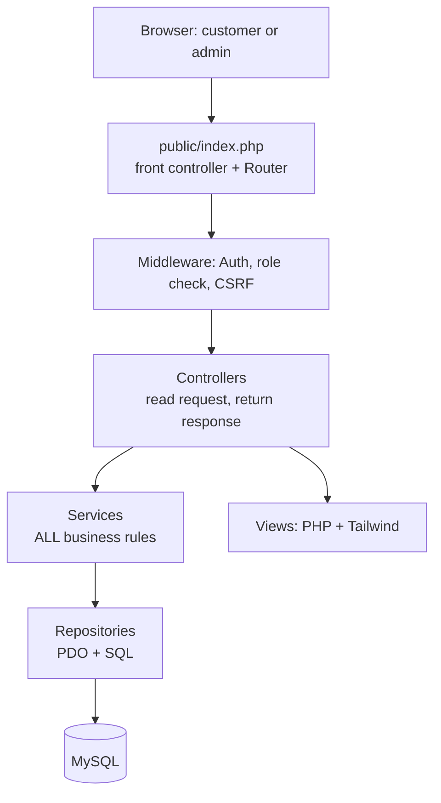
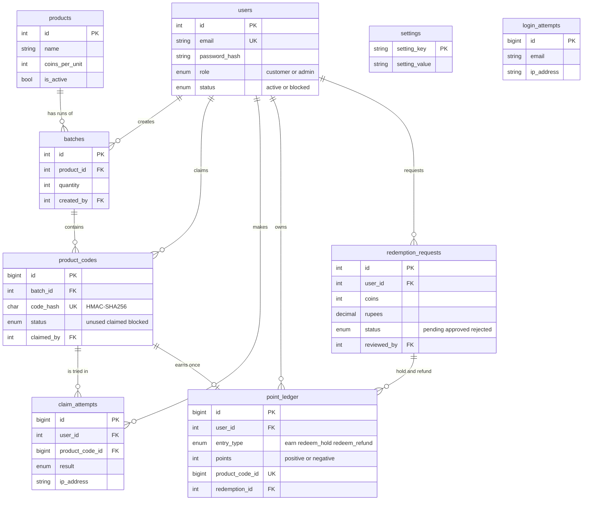
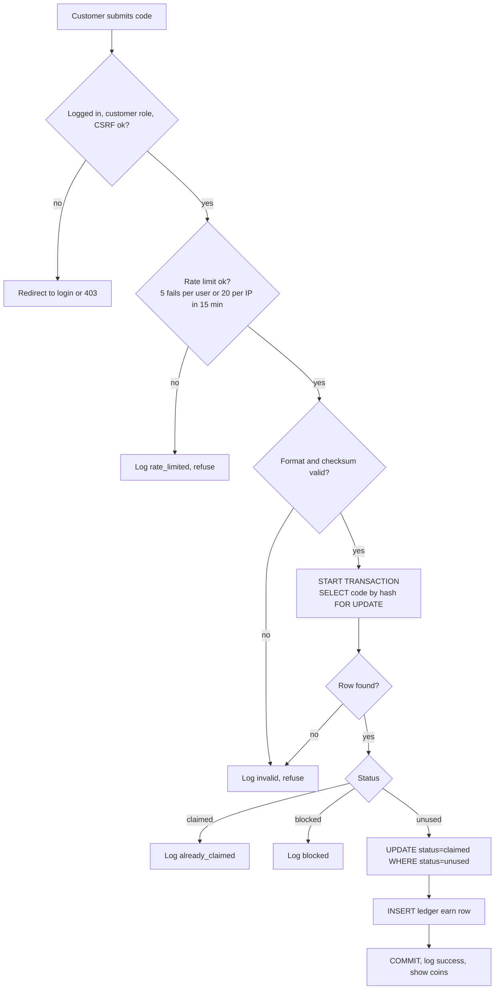
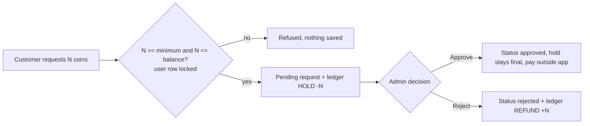

# Architecture

## 1. Stack and reasons

| Layer | Choice | Reason |
|---|---|---|
| Backend | PHP 8.2, plain OOP, no framework | The developer's strongest language. Every line is explainable (sessions, hashing, transactions) instead of hidden in a framework. |
| Database | MySQL / MariaDB (InnoDB) | Foreign keys, row locks (`SELECT ... FOR UPDATE`) and transactions are needed for safe claiming. |
| DB access | PDO, real prepared statements | Prevents SQL injection. |
| Front end | PHP views, Tailwind CSS (CDN), Chart.js (CDN) | Modern look without a build tool. |
| QR generation | `endroid/qr-code` 5.0 (SVG) | Server-side, sharp when printed. |
| QR scanning | `html5-qrcode` | Camera scanning in the browser, no app needed. |
| Auth | PHP sessions, `password_hash` (bcrypt), CSRF tokens | Standard and simple to explain. |
| Tests | PHPUnit 10 | Automated tests including a multi-process race test. |
| AI (optional) | Anthropic Messages API via cURL | Summaries only, with a rule-based fallback. |

## 2. Layers



Rule: controllers contain no business logic. "Is this code valid and unused?" lives only in `ClaimService`; redemption rules only in `RedeemService`.

## 3. Data model



Key design decisions:

1. **Ledger.** A balance is never stored. It is `SUM(points)` over a user's ledger rows, so history and balance cannot disagree. Rows are never edited.
2. **Hashed codes.** Only the HMAC hash is stored, so a leaked database contains no valid codes.
3. **Two layers stop double claims.** The `UPDATE ... WHERE status='unused'` inside a transaction, and `UNIQUE(point_ledger.product_code_id)`.
4. **No deletes.** Foreign keys use the default restrict, so financial history cannot be deleted by accident.

## 4. Claim flow



If two people submit the same code at the same instant, the second waits on the row lock, then sees `claimed`. This is proven by `tests/RaceTest.php` (8 separate PHP processes, exactly 1 wins).

## 5. Redemption flow



Approve and reject only act on `pending` requests, so a request cannot be handled twice.

## 6. Security measures

| Threat | Defence |
|---|---|
| SQL injection | PDO real prepared statements everywhere |
| Stolen database | Passwords bcrypt-hashed. Codes stored only as keyed HMAC hashes |
| Guessing codes | 59-bit random codes, checksum, rate limit, every attempt logged |
| Double claim / race | Row lock, conditional update, UNIQUE ledger constraint, tested with parallel processes |
| Negative balance | Balance checked inside a transaction with the user row locked |
| Session fixation / hijack | Session ID regenerated at login, HttpOnly + SameSite cookies, 30 min idle timeout |
| CSRF | Token on every POST form, checked on the server with `hash_equals` |
| XSS | All output escaped with `htmlspecialchars` |
| Privilege escalation | Role checked on every admin route. The user is re-read from the database on every request, so blocking is immediate. Role is never taken from a form |
| Password guessing | Login throttle, identical error for wrong email and wrong password |
| Clickjacking, sniffing, caching | `X-Frame-Options`, `X-Content-Type-Options`, `Cache-Control: no-store` |
| Secrets in Git | `.env` is ignored. `.env.example` has placeholders only |

## 7. Routes

| Method | Path | Who |
|---|---|---|
| GET | `/health` | public |
| GET/POST | `/register`, `/login` | public |
| POST | `/logout` | logged in |
| GET | `/dashboard`, `/history`, `/claim`, `/scan`, `/redeem` | customer |
| POST | `/claim`, `/redeem` | customer |
| GET | `/admin`, `/admin/products`, `/admin/batches`, `/admin/batches/sheet`, `/admin/codes`, `/admin/customers`, `/admin/redemptions` | admin |
| POST | `/admin/products/{create,update,toggle}`, `/admin/batches/{generate,block}`, `/admin/codes/{lookup,block,unblock}`, `/admin/customers/toggle`, `/admin/redemptions`, `/admin/insights` | admin |

## 8. Folder structure

```
public/        web root (index.php, .htaccess)
src/Config     Env loader, Database
src/Http       Session, Csrf, Url, View, Response
src/Middleware Auth
src/Controllers, src/Services, src/Repositories
views/         PHP templates (auth, customer, admin)
database/      schema.sql, seed_admin.php
tests/         PHPUnit tests, TEST_PLAN.md
```
